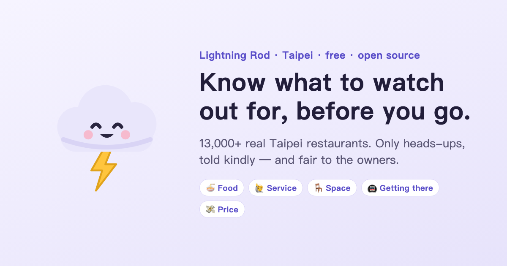

<p align="center">
  
</p>

<h1 align="center">Lightning Rod · 避雷針</h1>

<p align="center">
  <b>Know what to watch out for, before you go.</b><br>
  A Taipei food map that only collects heads-ups — told kindly, and fair to the owners.
</p>

<p align="center">
  <a href="https://bileizhen.01-crumbs.workers.dev/en/"><b>Open the map</b></a> ·
  <a href="https://bileizhen.01-crumbs.workers.dev/">中文版</a> ·
  <a href="#中文說明">中文說明</a>
</p>

<p align="center">
  
</p>

---

## What it is

Star ratings mash everything into one number. Lightning Rod only answers one question: **what might go wrong here?**

Its mascot is **Lei** (雷, "thunder"), an honest but gentle little thundercloud: *"I thunder to warn, not to strike."*

- **Real Taipei**: 13,399 real restaurants and cafés from OpenStreetMap. They have names, locations and cuisine only. No reviews are attached to real places; warnings come only from people who use the app.
- **Demo mode**: 24 *fictional* places with sample reports, so you can see how scoring, owner replies and improvements work.
- **Five aspects, no overall score**: food, service, space, getting there, price. Each has its own warning level.
- **Reporting in three steps**: pick the aspect → pick what happened and how bad → describe it and add a **required suggestion for the owner**.
- **Tone check**: insults like "garbage" or "scam" (and their Chinese equivalents) get a gentle nudge from Lei to rephrase before you can send.
- **Owner mode**: owners can post a public reply and mark what they've fixed.
- **Points & badges**: rewards being helpful, not being harsh.
- **Official hygiene records**: each real place links to the Taipei Department of Health's inspection map.
- **English & 中文**: switch anytime.

## How it stays fair to owners

| Rule | Why |
|---|---|
| Aspects, no overall score | "Hard to get to" isn't "bad food". No "awful place" labels |
| Three makes it count | An aspect counts only after 3 different people report it — one grudge can't sink a shop |
| Every report needs a suggestion | Complaints become a to-do list the owner can act on |
| Owners see it first for 72 hours | A chance to fix things before it's public (on by default) |
| Warnings fade | Half-life of 6 months; archived after a year |
| Fixing it clears it | Once 3 customers confirm an improvement, old warnings keep only 15% of their weight |
| Points for helping | Report +15 (incl. suggestion), confirm an improvement +8, "me too" gives nothing |

## Run it locally

Plain HTML + JS, no build step:

```bash
cd site && python3 -m http.server 8000
```

Then open <http://localhost:8000/> (中文) or <http://localhost:8000/en/>. Everything you do is saved in your browser (localStorage).

```
site/index.html, site/en/index.html   the page in 中文 / English
site/i18n.js      language: L('中文', 'English') pairs
site/data.js      fictional demo places and sample reports (both languages)
site/taipei.js    real Taipei restaurants from OpenStreetMap (rebuild: python3 tools/build_taipei.py)
site/app.js       scoring, map (Leaflet), list, report flow, owner mode, profile, imports
worker/           cookie-free page-view counter (Cloudflare Workers + D1)
```

Restaurant data © [OpenStreetMap contributors](https://www.openstreetmap.org/copyright), ODbL.

## License

Code: [MIT](LICENSE). Map data: ODbL (OpenStreetMap).

---

## 中文說明

**去之前，先知道要注意什麼。** 避雷針是只收避雷資訊的台北美食地圖。吉祥物「阿雷」是一朵誠實但溫柔的小雷雲：「我打雷是為了提醒，不是為了劈人。」

- **打開地圖**：<https://bileizhen.01-crumbs.workers.dev/>
- **真實台北**：OpenStreetMap 上 13,399 家台北真實餐廳，只有名稱、位置、料理類型，**不附任何評論**；雷只來自真實使用者的回報
- **功能示範**：24 家**虛構**店家和示範回報，用來展示計分、店家回應、改善機制
- **五個向度、沒有總分**：食物、服務、環境、交通、價格
- **三步驟回報**：選向度 → 選狀況和雷度 → 描述，並**必填一句給店家的建議**
- **語氣檢查**：偵測到「黑店」「垃圾」等字眼，阿雷會請你換個說法才能送出
- **對店家公平**：三人成雷、先給店家看 72 小時、雷會消散、改善後 3 位客人確認就洗白
- **官方衛生稽查**：每家真實店家都連到臺北市衛生局 iMAP
- **中英文**：隨時切換

歡迎開 issue 或寫信到 yolanda921223@gmail.com。
